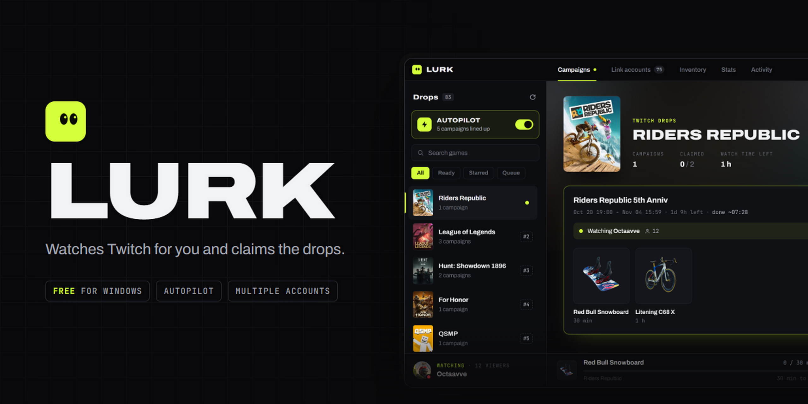
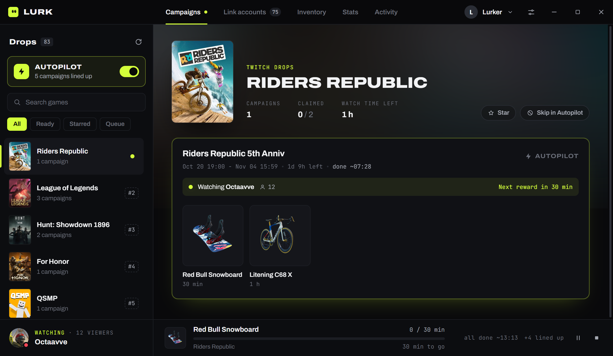
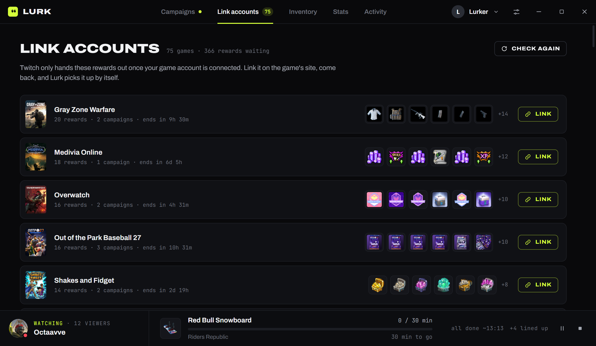
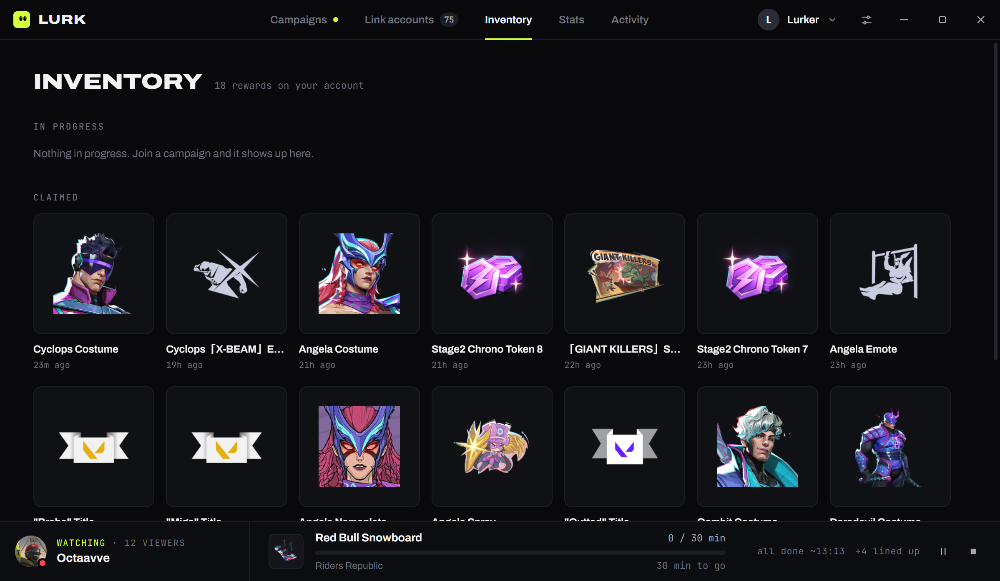
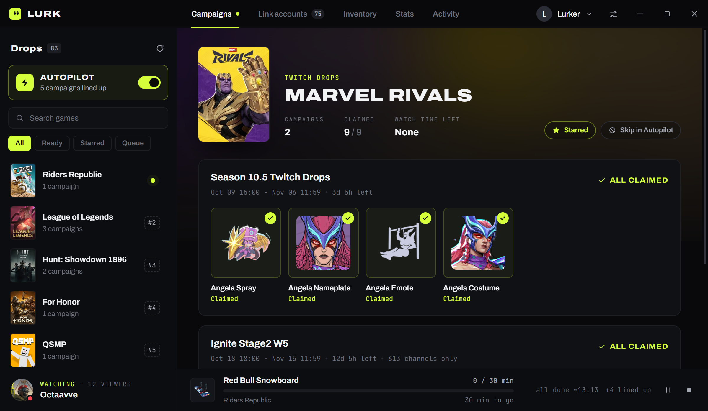
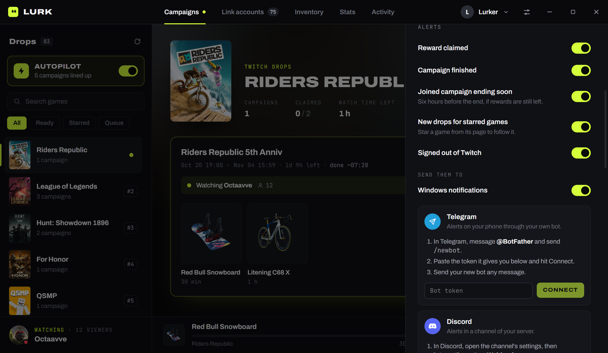
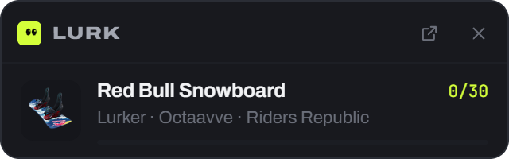

<p align="center">
  
</p>

<p align="center">
  <a href="https://pub-cbce00e549bc451ab552fe28377341c2.r2.dev/Lurk-Setup.exe"><b>Download for Windows</b></a>
  &nbsp;·&nbsp;
  <a href="#features">Features</a>
  &nbsp;·&nbsp;
  <a href="#faq">FAQ</a>
  &nbsp;·&nbsp;
  <a href="#build-it-yourself">Build it yourself</a>
</p>

Lurk is a Windows app that farms Twitch Drops for you. Sign in with Twitch, join the campaigns you want (or turn on Autopilot), and close the window. Lurk keeps a stream "open" in the background, follows your progress and claims every reward the moment it unlocks.

It never downloads video. Watching costs a few tiny requests every 20 seconds, so you can leave it running while you play.

All screenshots below are from the real app on a real account.

<p align="center">
  
</p>

## Features

**Farming**

- **Autopilot.** One switch and Lurk farms every campaign your account can earn. Starred games go first, then whatever ends soonest. Campaigns that can't finish a single reward before they end are skipped, because Twitch only pays out complete drops.
- **Smart channel picking.** One channel can count for several campaigns at once. Lurk picks the live channel that covers the most of yours, so they progress together.
- **Several accounts at once.** Add as many Twitch accounts as you like. Each one farms on its own, and "Join on all accounts" joins a campaign everywhere with one click.
- **Auto-claim.** Rewards are claimed as soon as they unlock, including the ones you earn by watching on your own.
- **Channel points.** The 15-minute bonus on the channel being watched is collected too.
- **Finish times.** Every campaign shows when it should be done, or warns you when it can't finish before it ends.

**Keeping you in the loop**

- **Alerts** for claimed rewards, finished campaigns, joined campaigns ending soon, new drops for games you starred, and being signed out. They go to Windows notifications, your own Telegram bot and/or a Discord channel.
- **Telegram remote control.** Send your bot `/status`, `/pause`, `/resume`, `/autopilot on` or `/today` from your phone.
- **Mini widget.** A small always-on-top window with every account's current reward and progress.
- **Stats.** Rewards per week and month, hours farmed per day, channel points, per account.

**Comfort**

- **Link accounts page.** Many drops only count once your game account is linked on Twitch. Lurk lists every game waiting on a link, how many rewards each one unlocks, and checks again by itself when you come back.
- **Star games you own.** Lurk can read your Steam and Epic libraries and star those games for you.
- **Schedule.** Farm only during the hours you pick, and hold automatically while a fullscreen game is running.
- **Quiet by design.** Lives in the tray, starts with Windows if you want, and updates itself.

<table>
  <tr>
    <td width="50%"></td>
    <td width="50%"></td>
  </tr>
  <tr>
    <td>Every game whose rewards wait on a linked account</td>
    <td>Everything already claimed on the account</td>
  </tr>
  <tr>
    <td width="50%"></td>
    <td width="50%"></td>
  </tr>
  <tr>
    <td>Two Marvel Rivals campaigns, fully claimed</td>
    <td>Alerts to Windows, Telegram and Discord</td>
  </tr>
</table>

<p align="center">
  <br>
  <sub>The mini widget sits on top of your game.</sub>
</p>

## Install

1. [Download Lurk-Setup.exe](https://pub-cbce00e549bc451ab552fe28377341c2.r2.dev/Lurk-Setup.exe) (Windows 10 or 11, 64-bit).
2. Run it. Windows may show "Windows protected your PC" because the installer isn't code-signed. Click **More info**, then **Run anyway**.
3. Click **Continue with Twitch** and sign in on Twitch's own login page. The window closes by itself once you're in.

New versions download in the background and install the next time Lurk starts.

## How it works

- **Sign-in.** Lurk opens Twitch's login page in its own window and keeps only the session Twitch hands back. It never sees your password. Sessions are stored encrypted with Windows' own account encryption (DPAPI).
- **Campaigns and progress** come from the same Twitch endpoints the Twitch website and app use.
- **Watching.** Every 20 seconds Lurk asks Twitch for the stream's playlist and touches its newest video segments without downloading them. That is what makes Twitch count you as a viewer.
- **Claiming.** Lurk checks your drop inventory every few minutes and claims anything that's ready.
- **When Twitch changes something.** Twitch sometimes renames the internal requests Lurk relies on. Lurk notices, fetches the current names, and carries on. If that isn't enough, an update follows.

## Privacy

What stays on your PC:

- Your Twitch sessions, Telegram bot token and Discord webhook, all encrypted.
- A detailed log in `%APPDATA%\Lurk\logs`, kept for 7 days. Tokens and passwords are scrubbed from every line before it's written.

What can leave your PC, and how to stop it (Settings, **Help and privacy**):

- **Problem reports** you send yourself. You see exactly what's included before sending. Your Twitch names are only included if you tick the box.
- **Crash reports.** The error and the last log lines, with your Twitch names replaced by "account-1", "account-2". On by default, one switch to turn off.
- **Anonymous usage stats.** Lurk's version and how many accounts it runs, every few hours. No names. One switch to turn off.

Lurk never sends your sessions or tokens anywhere except Twitch.

## FAQ

**Is this allowed by Twitch?**
No. Automated watching is against Twitch's Terms of Service. Plenty of people farm drops with tools like this, but use it knowing that.

**Can my account get banned?**
It's possible. From what's public, Twitch rarely acts on small-scale drop farming; the more common outcome is drops that stop counting. Twitch doesn't flag you for sharing an internet connection; what stands out is the pattern. Lurk doesn't run the real video player, and several accounts doing the same thing around the clock from one address look like a bot. The more accounts you run, the higher the risk. Don't use an account you can't afford to lose.

**Why does a campaign say "Link account"?**
The game's publisher only grants those rewards to a linked game account. Open the **Link accounts** tab, link the game on its site, and come back. Lurk picks it up by itself.

**Progress isn't moving. What now?**
Twitch only updates drop progress about once a minute, and some channels stop counting time. Lurk notices a channel that isn't counting and moves to another one. If it stays stuck, use **Report a problem** in Settings.

**Does it use much bandwidth or CPU?**
No. It never downloads video, only a few small requests per account every 20 seconds.

**Mac or Linux?**
Not yet. Lurk is built with Electron, so a port is possible, but only Windows is built and tested.

## Build it yourself

You need [Node.js](https://nodejs.org) 20 or newer.

```bash
git clone https://github.com/Kh8da/lurk.git
cd lurk
npm install
npm start
```

| Command | What it does |
| --- | --- |
| `npm start` | Run Lurk from source |
| `npm run demo` | Run with fake data, no Twitch account needed |
| `npm test` | Engine and helper tests (farming rules, claiming, Autopilot, log scrubbing) |
| `npm run dist` | Build `dist/Lurk-Setup-<version>.exe` |
| `npm run icon` | Redraw the app icon from `tools/make-icon.js` |
| `npx electron tools/render-art.js` | Redraw the README banner from `docs/art/banner.html` |

If `npm install` leaves `node_modules/electron/dist` empty, run `node node_modules/electron/install.js`.

<details>
<summary><b>Project layout</b></summary>

```
main.js              app window, tray, alerts, wiring
preload.js           the bridge between the window and the app
src/
  engine.js          the farm loop for one account
  accounts.js        several accounts, sign-in, sign-out
  twitch/            Twitch client, login window, query names
  settings.js        shared settings
  telegram.js        Telegram alerts and commands
  discord.js         Discord webhook alerts
  library.js         Steam and Epic library scan
  gaming.js          fullscreen game detection
  logger.js          the local log and its scrubbing
  reports.js         problem reports, crash reports, replies
  updater.js         self-updates
  demo.js            fake data for npm run demo
renderer/            the interface (Preact + htm, no build step)
server/              the report server (Cloudflare Worker, D1, R2)
test/                node:test suites
tools/               icon, release and banner scripts
```

</details>

<details>
<summary><b>Running your own builds and report server</b></summary>

A fork that ships its own builds should change two addresses:

- `build.publish` in `package.json`: where installed copies look for updates.
- `API` in `src/reports.js`: where problem and crash reports go.

The report server in `server/` is a Cloudflare Worker with a D1 database and a private R2 bucket for logs. It accepts reports, keeps install pings, lets you reply to reporters, and has an admin API that the app shows as an **Admin** tab when it holds your admin key.

```bash
npx wrangler d1 create lurk                        # put the id in server/wrangler.jsonc
npx wrangler r2 bucket create lurk-reports
npx wrangler d1 execute lurk --remote --file server/schema.sql --config server/wrangler.jsonc
npx wrangler deploy --config server/wrangler.jsonc
npx wrangler secret put ADMIN_KEY --config server/wrangler.jsonc
```

Put the same key and your server address in an untracked `keys.local.json` (`{ "api": "...", "adminKey": "..." }`) to run `server/smoke.mjs`, which checks the live server end to end. To unlock the Admin tab in the app, click the version number at the bottom of Settings five times and paste the key.

Releases go to an R2 bucket with `npm run dist` then `npm run release`, with `CLOUDFLARE_ACCOUNT_ID` set or `cloudflareAccountId` in `keys.local.json`.

</details>

## Credits

- Twitch query research from [TwitchDropsMiner](https://github.com/DevilXD/TwitchDropsMiner) by DevilXD. Lurk is a separate app, but it wouldn't exist without that project's work on Twitch's internals.
- [Archivo](https://fonts.google.com/specimen/Archivo) and [JetBrains Mono](https://www.jetbrains.com/lp/mono/), under the SIL Open Font License.
- [Preact](https://preactjs.com) and [htm](https://github.com/developit/htm).

Lurk is not affiliated with or endorsed by Twitch. Game names, box art and reward images belong to their owners.

## License

[MIT](LICENSE)
